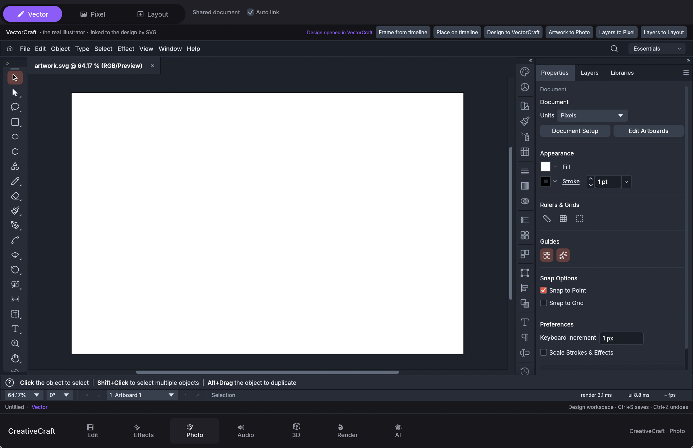
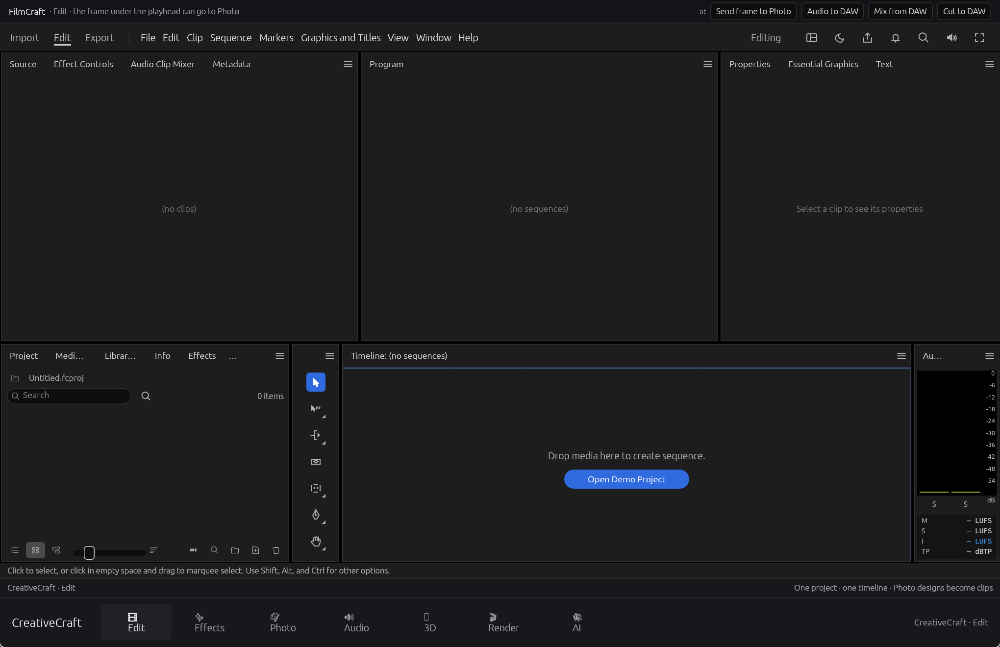

# CreativeCraft


One Windows window that hosts seven creative tools, with the page tabs along the
bottom edge like DaVinci Resolve.

<p align="center">
  
</p>

*First launch, Photo tab (Vector persona). A blank 1200×800 artboard: no sample
design, no layers, and no shared timeline yet. The tab bar sits along the bottom
edge, DaVinci-style.*

| Tab | App it hosts | What you can do there |
|---|---|---|
| **Edit** | FilmCraft | Import media, build a cut on the timeline, use the program monitor, markers and the Export screen. |
| **Effects** | EffectCraft | Node-based compositing, keyframes, OpenFX plug-ins and a render queue. |
| **Photo** | PhotoCraft + the shared design | Three personas on one document: **Vector** (paths, shapes, fills), **Pixel** (paint, erase, masks) and **Layout** (FigCraft frames, text, auto layout). |
| **Audio** | FilmCraft audio + SoundCraft | The same cut's audio: clips, mixer, and a hand-off to the sound editor. |
| **3D** | EffectCraft Advanced 3D | Placeholder. The panel exists, but this is not a working modeller yet. |
| **Render** | FilmCraft Export + EffectCraft queue | Export presets and background renders. |
| **AI** | Maestro | A local AI video, image and music studio, running in its own web view. |

The apps are not reimplementations or screenshots: each tab runs the real
application and its real engine. The shell only supplies the window, the theme
and the hand-offs between them (a frame from Edit can become a photo layer, a
design can become clips, and so on).

Version **0.1.0**. Early, and honest about what it does not do yet.

<p align="center">
  
</p>

*First launch, Edit tab. An "Untitled" project with 0 items and no sequence.
Nothing is loaded until you import media or create one.*

---

## Run it (no installation, no Rust)

**Windows 10 or 11, 64-bit.** No installer, no Rust toolchain, nothing else to
install; to remove CreativeCraft, delete the folder.

1. Open the [**latest release**](https://github.com/its-cybru/creativecraft/releases/latest).
2. Download `CreativeCraft-0.1.0-win64.zip`.
3. Unzip it anywhere and double-click `CreativeCraft.bat` (or `CreativeCraft.exe`).

Windows will warn that the publisher is unknown, because the build is not
code-signed. Choose **More info → Run anyway**.

If Windows reports a missing `VCRUNTIME140.dll`, install the free Microsoft
Visual C++ 2015-2022 Redistributable (x64), then start CreativeCraft again.

Full release notes, requirements and limits are in the `README.txt` inside the
ZIP.

## Build it from source

You need [Rust](https://rustup.rs) (stable, MSVC toolchain) and the Microsoft
C++ build tools.

```powershell
cd creativecraft\studio-shell
cargo run
```

The first build takes a long time and roughly 25 GB of disk in
`creativecraft\studio-shell\target`. That folder is build scratch space, is
ignored by git, and can be deleted at any time.

Run the shell's tests with:

```powershell
cd creativecraft\studio-shell
cargo test
```

## Folder layout

```
CreativeCraft.bat          development launcher (runs the debug build)
creativecraft/
  studio-shell/            the window: tabs, hosting, menu bar  <-- start here
  effectcraft/             Effects app (OpenFX host, node graph)
  filmcraft/               Edit, Audio and Render
  photocraft/              Photo
  figcraft/                design tool, hosted inside Photo's link panel
  vectorcraft/             vector editor
  soundcraft/              sound tools
  solidcraft/              not hosted (different egui version)
  libs/                    shared crates used by the apps
```

## What is verified

- The window opens on an **empty project**: blank canvas in Photo, no clips or
  sequences in Edit. Nothing is pre-filled.
- Every tab hosts the real application, not a mock-up.
- The Studio (Dark) theme is PhotoCraft's default.
- OpenFX renders on the CPU. ToneLab Chroma and Trioscope Raytracing Relight
  were confirmed with real frames (Trioscope at 1920×1080).
- Plug-ins run in a separate helper process, so a crashing plug-in cannot take
  the window down.
- `studio-shell` tests: 63 passing.

## Known limits

- **3D is a placeholder.** EffectCraft's Advanced 3D panels exist, but the 3D
  tab is not a working modeller yet.
- **Red Giant** (Magic Bullet, Universe), **Boris FX**, **Topaz Video AI** and
  the **DaVinci Resolve Renderer** do not render here.
  - Red Giant loads and describes its parameters, then refuses to render; it
    needs a GPU-memory render pipeline this build does not provide.
  - Boris FX is installed as the Adobe `.aex` edition; this host loads only
    OpenFX `.ofx` plug-ins.
  - Topaz and Resolve are built to run inside their own applications.
- Plug-ins that draw on-screen handles (masks, trackers, widgets) render the
  picture but do not show their handles.
- CPU plug-ins render one frame per call through a single helper process:
  correct, but slower than a built-in effect.
- The first launch scans installed OpenFX plug-ins and can take up to about
  90 seconds on a machine with many of them. Later launches use a cache.

## Licence and credits

The CreativeCraft shell (`creativecraft/studio-shell/`) is MIT licensed; see
[LICENSE](LICENSE).

CreativeCraft bundles modified copies of these MIT OR Apache-2.0 projects.
Each one keeps its own `LICENSE-MIT`, `LICENSE-APACHE`, `NOTICE` and
`ATTRIBUTION.md`, and those terms apply to that app's code:

| Folder | Upstream |
|---|---|
| `effectcraft/` | github.com/storytold/effectcraft |
| `filmcraft/` | github.com/storytold/filmcraft |
| `photocraft/` | github.com/storytold/photocraft |
| `figcraft/` | github.com/storytold/figcraft |
| `vectorcraft/` | github.com/storytold/vectorcraft |
| `soundcraft/` | github.com/storytold/soundcraft |
| `solidcraft/` | github.com/tangency-labs/solidcraft |
| `libs/` | github.com/storytold/craft-libs |

CreativeCraft is an independent project. It is **not** made, sponsored or
endorsed by the ArtCraft Team, the SolidCraft contributors, Red Giant, Boris FX,
Topaz Labs or Blackmagic Design. The ArtCraft logo folders (`docs/brand/`) are
trademarks and are deliberately not published here.

See [NOTICE](NOTICE) for the full statement.
